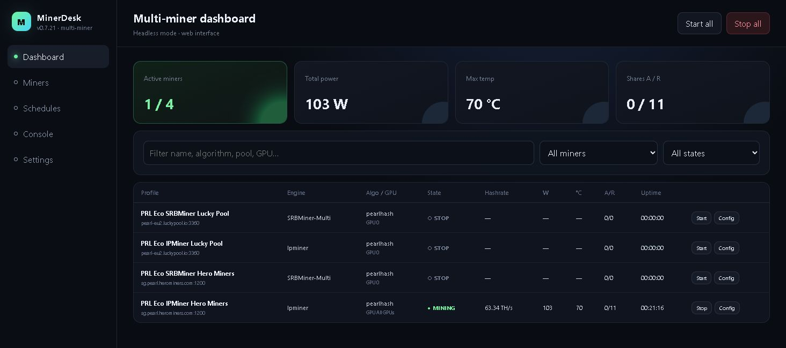
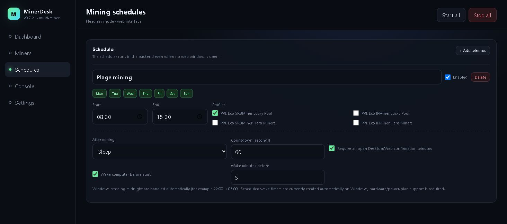

# MinerDesk

**Quantus (QTC) :** la version 0.7.23 ajoute le support volontaire QTC, désactivé par défaut (0 %), avec conservation du nom du worker. Consultez le [guide Quantus](QUANTUS.md) et le [tutoriel vidéo en anglais](https://www.youtube.com/watch?v=cCzC8PqDtEI). Seule une adresse publique de réception figure dans l'application ; aucune clé privée ni phrase de récupération n'est distribuée.

**Vos mineurs, vos horaires, un seul tableau de bord.**

MinerDesk centralise les profils, le lancement, la surveillance et la planification de plusieurs moteurs de minage dans une application de bureau et une interface web. C'est un orchestrateur : le minage est effectué par des logiciels tiers téléchargés séparément.

**MinerDesk 0.8.1 intègre [Fleet](FLEET.md) dans la version stable** pour piloter un groupe de rigs Windows et Linux depuis n'importe quelle instance associée.

[Télécharger la dernière version](https://github.com/jontechlabs/MinerDesk/releases/latest) · [Documentation complète en anglais](../README.md) · [Historique](../CHANGELOG.md)



## Ce que cela vous apporte

- Conserver plusieurs profils avec leurs pools, portefeuilles publics, GPU et réglages, sans multiplier les scripts de lancement.
- Programmer des plages hebdomadaires, y compris à cheval sur minuit, avec veille ou hibernation facultative après le minage.
- Suivre hashrate, puissance, température, shares et durée depuis le bureau ou un navigateur de confiance.
- Arrêter manuellement une session planifiée sans que le planificateur la relance immédiatement.
- Réunir plusieurs rigs dans Fleet, consulter leur dernière activité et recevoir le résultat de chaque commande distante.
- Utiliser SRBMiner-Multi, lolMiner, BzMiner, Rigel, lpminer, NPMiner, [OneZeroMiner](ONEZEROMINER.md), [PeakMiner](PEAKMINER.md) ou un exécutable personnalisé.

La version **0.7.39** ajoute PeakMiner, son téléchargement officiel vérifié par SHA-256, les profils PRL/Quantus et les réglages GPU communs. Pour PRL, utilisez `pearlhash` ou `pearl` ; consultez le [guide PeakMiner](PEAKMINER.md) pour les autres monnaies, les identifiants GPU et le mode root Linux.

La version 0.7.31 ajoute la fréquence mémoire et les décalages signés du cœur et de la mémoire, avec des champs adaptés au moteur. Voir le [guide des réglages GPU](GPU-TUNING.md).

Les réglages disponibles dépendent du moteur et du matériel. Les statistiques viennent de l'analyse de la sortie des mineurs ; elles ne constituent pas une garantie de performance ou de revenus. Le pourboire facultatif au développeur est désactivé par défaut (0 %).

## Installation

**Windows 10/11 x64 :** télécharger `MinerDesk_0.8.1_x64-setup.exe` depuis la Release. L'installeur configure le backend privilégié ; l'interface graphique reste exécutée comme utilisateur normal. L'archive portable s'appelle `MinerDesk_0.8.1_windows-x64.zip`.

**Linux x64 compatible Debian :** télécharger le paquet `.deb`, puis :

```bash
sudo apt install ./MinerDesk_0.8.1_amd64.deb
```

La signature Authenticode Windows reste en attente. Les mises à jour 0.7.24 des installateurs, AppImages et paquets Debian disposent d’une signature cryptographique vérifiée par MinerDesk. Comparez aussi leur SHA-256 au fichier `SHA256SUMS.txt` de la Release.

Les autres formats Linux sont `MinerDesk_0.8.1_amd64.AppImage` et `MinerDesk_0.8.1_linux-x64.tar.gz`. Consultez les notes de la Release pour connaître les systèmes et paquets effectivement vérifiés.

À partir de 0.7.24, recherche des versions stables toutes les 6 heures, confirmation avant installation, progression du téléchargement et lien GitHub lorsque la mise à jour automatique est indisponible. Installez 0.7.24 une première fois pour recevoir les prochaines mises à jour. [Guide des mises à jour](UPDATES.md).

Dans **Miners**, choisir un moteur, renseigner le pool et une adresse publique, sélectionner les GPU, sauvegarder et démarrer. **Console** permet de comprendre les erreurs. **Schedules** gère les plages horaires.



Captures réelles de l'interface web 0.7.21, conservée dans 0.7.24. Les valeurs illustrent une session et ne constituent pas un benchmark.

## Associer vos rigs avec Fleet

Fleet est **désactivé par défaut**. Il conserve les moteurs, réglages matériels et autorisations système sur chaque rig.

1. **Créer un coordinateur unique.** Ouvrir **Fleet** sur le PC choisi, lui donner un nom et vérifier l'adresse HTTPS LAN proposée, normalement `https://IP-DU-PC:17889`. Choisir l'interface réseau voulue et conserver une adresse stable.
2. **Générer une invitation.** Depuis le coordinateur, créer une invitation temporaire à usage unique. Transmettre son adresse et sa clé complète dans un échange privé avec le propriétaire du rig.
3. **Rejoindre le groupe.** Sur chaque autre instance Windows/Linux, saisir cette adresse et cette clé. La recherche de coordinateurs peut fournir l'adresse sur le LAN ; elle ne remplace pas l'invitation de confiance. Générer une nouvelle invitation pour chaque rig.

Fleet utilise HTTPS sur **TCP 17889**, avec une découverte LAN facultative sur **UDP 17990**. Les agents établissent leurs connexions vers le coordinateur. Entre plusieurs réseaux, utiliser un VPN de confiance ou configurer volontairement une adresse HTTPS joignable, la redirection du port sur le routeur et le pare-feu du coordinateur. MinerDesk ne configure pas automatiquement le routeur par UPnP. L'ancien accès HTTP sur 17888 doit rester sur un LAN/VPN de confiance.

**Chaque instance associée est un contrôleur de confiance du groupe.** Cette première version ne sépare pas les rôles lecteur, opérateur et administrateur. Les adresses de réception publiques et réglages autorisés sont visibles aux contrôleurs associés. Les mots de passe de pool restent locaux ; aucune clé privée de wallet ni aucun mot de passe root ne sont demandés ou transmis.

Une coupure du coordinateur n'arrête pas le minage ni les horaires locaux tant que le backend du rig reste ouvert. L'interface affiche l'heure des dernières mesures et le résultat des commandes ; un état hors ligne ne signifie pas que le mineur est arrêté. Les commandes expirent et les enregistrements concurrents sont refusés avec demande d'actualisation. Voir le [guide Fleet en français et en anglais](FLEET.md) pour les modifications autorisées, les approbations root locales et les sauvegardes privées.

## Contrôle et sécurité

Un arrêt manuel suspend les occurrences de planification en cours. Depuis la version 0.7.35, **Start / Restart / Start all** respectent les plannings activés affectés au profil : démarrage dans un créneau, attente du prochain sinon. **Forcer le minage** contourne explicitement les horaires, sans limite de temps ; **Reprendre le planning** rétablit les créneaux et arrête une session forcée si elle est hors horaires. Sans planning activé affecté, le démarrage reste immédiat. La prochaine occurrence reste disponible. Fermer un onglet web n'arrête pas le planificateur si le backend reste actif. Voir le [guide des plannings](SCHEDULING.md).

L'action explicite **Quitter** arrête le backend du bureau et ses mineurs. Avec Fleet actif, fermer la fenêtre Windows détache l'interface en conservant le backend ; sous Linux, cela masque l'application dans sa zone de notification. Le CLI autonome reste indépendant. Fleet n'installe pas automatiquement de service au démarrage et ne maintient pas une application ouverte après une fin de session ou l'arrêt du PC.

Ne jamais saisir de clé privée ou de phrase de récupération. Le mode local utilise `http://127.0.0.1:17888/`. L'accès LAN doit rester sur un réseau de confiance, avec un jeton fort ; privilégier un VPN et ne jamais exposer directement le service HTTP à Internet. Les profils, journaux et URL peuvent contenir des informations à masquer avant partage. Lire [SECURITY.md](../SECURITY.md).

## Compiler et contribuer

- [Compilation Windows](../SETUP-WINDOWS.md) : utiliser `scripts/build-windows.ps1`.
- [Compilation Linux](../BUILD-LINUX.md) : utiliser `bash scripts/build-linux.sh`.
- [Contribuer](../CONTRIBUTING.md) et [signaler un problème](https://github.com/jontechlabs/MinerDesk/issues).

MinerDesk est distribué sous [licence MIT](../LICENSE). Les moteurs tiers conservent leurs propres licences et frais.

Depuis la version 0.7.33, les réglages GPU nécessitant des droits administrateur peuvent utiliser une option root par profil Linux. Voir le [guide de lancement privilégié](LINUX-ELEVATION.md).
